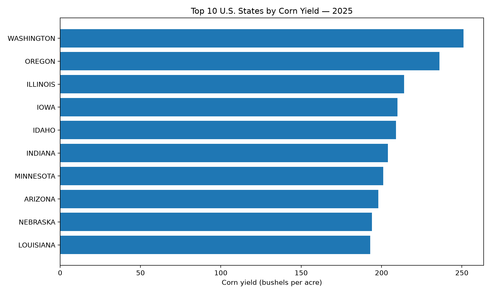
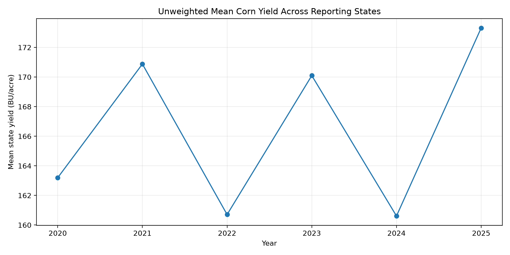
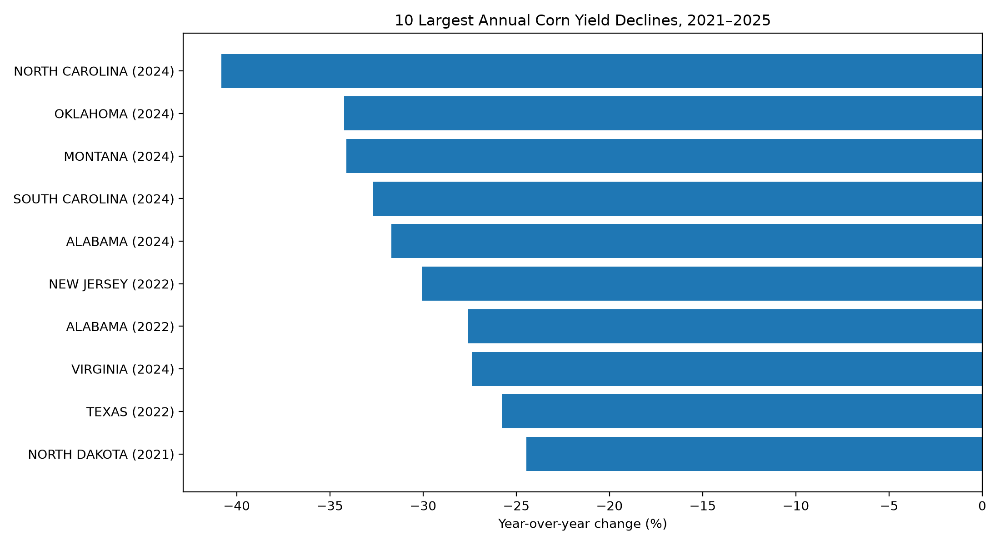

# USDA Agricultural Data Engineering and Risk Analytics

A reproducible agricultural data engineering and analytics project
using Python, PySpark, Spark SQL, and Delta Lake.

## Project Overview

This project processes USDA National Agricultural Statistics Service
(NASS) Quick Stats data through a Bronze-Silver-Gold architecture.

The objective is to demonstrate data ingestion, validation,
transformation, analytical SQL, automated testing, and agricultural
productivity risk screening.

## Technology Stack

- Python 3.13
- Apache Spark / PySpark 4.0.1
- Delta Lake 4.0.1
- Spark SQL
- Matplotlib
- pytest
- WSL2 Ubuntu

## Dataset

Source: USDA NASS Quick Stats
https://quickstats.nass.usda.gov/

- Commodity: Corn for grain
- Measurement: Yield, bushels per acre
- Reporting period: Annual
- Years: 2020-2025
- Observations: 252
- Geographic categories: 41 named states and OTHER STATES
- Unique annual observations per year: 42

The OTHER STATES aggregate is excluded from state rankings,
averages, and volatility comparisons.

## Data Architecture

USDA CSV
    |
    v
Preflight Validation
    |
    v
Bronze Delta Lake - Raw structured ingestion
    |
    v
Silver Delta Lake - Cleaned and standardized records
    |
    v
Gold Delta Lake - Analytical state-year aggregates
    |
    v
Spark SQL + Python Analytics + Visualizations

## Data Quality

The pipeline validates source fields, filters incompatible
reporting periods, handles nonnumeric values, and checks
analytical record uniqueness.

The nationwide data run produced:

- 252 source records
- 252 eligible numeric records
- 252 Bronze rows
- 252 Silver rows
- 252 Gold groups

Eight automated tests passed.

## Analytical Findings

### 2025 Yield Rankings

- Washington: 251 bushels per acre
- Oregon: 236 bushels per acre
- Illinois: 214 bushels per acre
- Iowa: 210 bushels per acre

### Largest Observed Annual Decline

North Carolina experienced a 40.82% year-over-year decline in
corn yield in 2024, the largest decline in this dataset.

### Six-Year Yield Volatility

North Carolina had the highest sample standard deviation
of annual yield: 24.36 bushels per acre.

### Average State Yield

The unweighted mean yield across 41 named states increased
from 163.20 bushels per acre in 2020 to 173.32 in 2025.

These unweighted state averages are not national
production-weighted USDA yield estimates.

## Visualizations

### Top 10 States by 2025 Corn Yield

### Corn Yield Trends, 2020-2025

### Largest Year-over-Year Yield Declines

## Spark SQL

The SQL analyses include:

1. State-level yield rankings
2. Year-over-year yield changes using LAG()
3. Multi-year yield volatility using STDDEV_SAMP()

SQL queries:
[agricultural_risk_analytics.sql](sql/agricultural_risk_analytics.sql)

## Reproducing the Analysis

Install the project dependencies in a compatible Python
environment with Java 17 available.

Install dependencies using:

    uv pip install -r requirements.txt

Validate the USDA Quick Stats source export:

    python -m src.preflight --csv data/raw/usda_corn_all_states_original.csv

Execute the Spark pipeline:

    python -m src.pipeline --source real --csv data/raw/usda_state_crop_clean.csv

Run Spark SQL:

    python run_spark_sql.py

Generate the visualizations:

    python analyze_usda.py

Run the automated test suite:

    python -m pytest -q

## Agricultural Credit-Risk Relevance

Agricultural yield variation may help identify geographic
exposures requiring further investigation by agricultural
lenders and financial regulators.

These metrics are screening indicators, not measures
of borrower default probability or credit loss.

A financial-risk model would require additional information
such as commodity prices, loan balances, debt-service
capacity, and financial institution exposures.

## Limitations

- The dataset covers six annual reporting periods.
- The data includes one crop and 41 individually named states.
- Yield observations are not weighted by planted or harvested area
  when computing cross-state averages.
- Geographic yield differences do not establish causal risk factors.
- The project demonstrates a Spark and Delta Lake workflow on a
  modest dataset; it is not a large-scale performance benchmark.

## Author

Andrew Klein

Cybersecurity, Data Analytics, Python, SQL, and Risk Management
